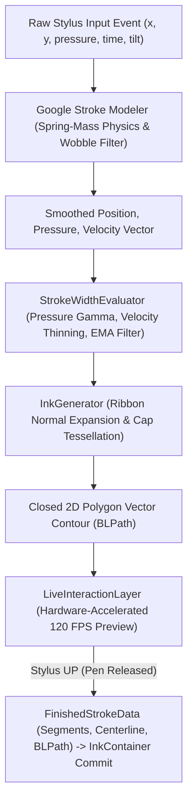

# Ink Engine Subsystem

## Overview
The `InkEngine` subsystem powers low-latency, physics-based digital ink generation, real-time spline interpolation, 2D polygon contour meshing, and spatial stroke collision detection.

---

## Directory Structure

```text
src/core/ink_engine/
├── ink_config.hpp              # Configuration parameters for physics, filters, and width equations
├── ink_engine.hpp              # High-level coordinator managing live inking sessions and stroke lifecycles
├── ink_engine.cpp              # Implementation connecting smoothing, meshing, and layer commit
├── ink_stroke_data.hpp         # Core geometric structures: Point2D, Segment1D, FinishedStrokeData
├── stroke_width_evaluator.hpp  # Non-linear pressure curves, hydrodynamic velocity thinning, EMA smoothing
├── ink_generator.hpp  # Variable-thickness 2D polygon contour tessellation (round/square/chisel)
└── stroke_collision.hpp        # Segment-to-point and segment-to-circle distance & collision tests
```

---

## Inking Data Pipeline



---

## Mathematical Foundations

### 1. Physics-Based Smoothing (Google Stroke Modeler)
Raw digitizer events undergo continuous spring-damper simulation to filter jitter and high-frequency hardware noise:

$$m \ddot{x} + c \dot{x} + k(x - x_{\text{target}}) = 0$$

Where:
* $k$ is the spring-mass constant (controls responsiveness and tracking inertia).
* $c$ is the drag damping constant (prevents oscillation or overshoot).
* **Wobble Smoothing**: Applies timeout-based velocity thresholds to filter physiological hand tremor.
* **Loop Mitigation**: Prevents fast cursive loops and curves from contracting.
* **Angle Upsampling**: Injects intermediate samples along sharp turns to maintain smooth curvature.

### 2. Dynamic Stroke Thickness (`StrokeWidthEvaluator`)

Stroke thickness is evaluated through a multi-stage hydrodynamic physical model:

1. **Hardware Pressure Mapping (Power-Law Gamma)**:
   $$p_{\text{norm}} = \text{clamp}\left(\frac{p - p_{\text{deadzone}}}{p_{\text{saturation}} - p_{\text{deadzone}}}, 0, 1\right)$$
   $$p_{\text{curved}} = p_{\text{norm}}^\gamma$$
   $$W_{\text{pressure}} = W_{\text{base}} \cdot (m_{\text{min}} + p_{\text{curved}} \cdot (m_{\text{max}} - m_{\text{min}}))$$

2. **Velocity Thinning (Fountain Pen Simulation)**:
   $$v_{\text{norm}} = \text{clamp}\left(\frac{v \cdot \text{zoom}}{v_{\text{max}}}, 0, 1\right)$$
   $$f_{\text{thin}} = 1.0 - v_{\text{norm}} \cdot (1.0 - m_{\text{min}})$$

3. **Tilt Factor**:
   $$f_{\text{tilt}} = \text{CalculateTiltWidthFactor}(\theta_x, \theta_y)$$

4. **Target Width & Exponential Moving Average (EMA) Smoothing**:
   $$W_{\text{target}} = W_{\text{pressure}} \cdot f_{\text{thin}} \cdot f_{\text{tilt}}$$
   $$W_t = \text{EMA}(W_{t-1}, W_{\text{target}}, \alpha)$$

### 3. Variable-Width Contour Meshing (`InkGenerator`)
Given center-line tangent $\vec{T} = \frac{d P(u)}{du}$, the unit normal vector is:

$$\hat{N} = \frac{(-T_y, T_x)}{\sqrt{T_x^2 + T_y^2}}$$

Left and right boundary vertices are generated as:
$$V_{\text{left}}(u) = P(u) + \frac{W(u)}{2} \cdot \hat{N}$$
$$V_{\text{right}}(u) = P(u) - \frac{W(u)}{2} \cdot \hat{N}$$

End caps (Round, Square, Chisel) are tessellated with vertex fans, and closed 2D polygon ribbons are fed directly to Blend2D for anti-aliased subpixel rasterization.

---

## Collision & Erasure Mechanics (`stroke_collision.hpp`)
* **Broadphase**: Evaluates overlap between the eraser's circular bounding box and the stroke's minimum bounding box (AABB).
* **Narrowphase**: Performs capsule segment-to-point and segment-to-circle distance checks:
  $$d_{\text{segment}}(Q, A, B) = ||Q - (A + \text{clamp}(t, 0, 1) \cdot (B - A))||$$
  Where $t = \frac{(Q - A) \cdot (B - A)}{||B - A||^2}$.
